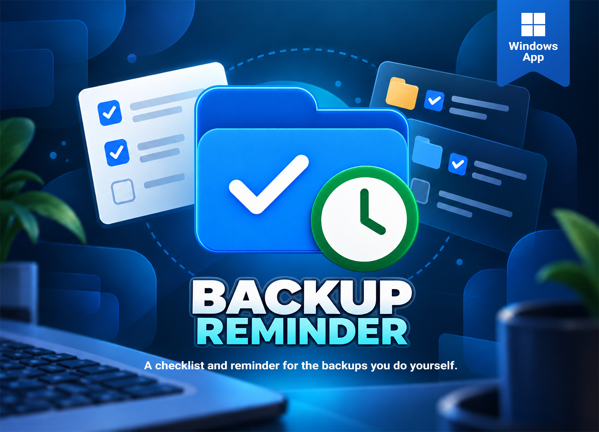
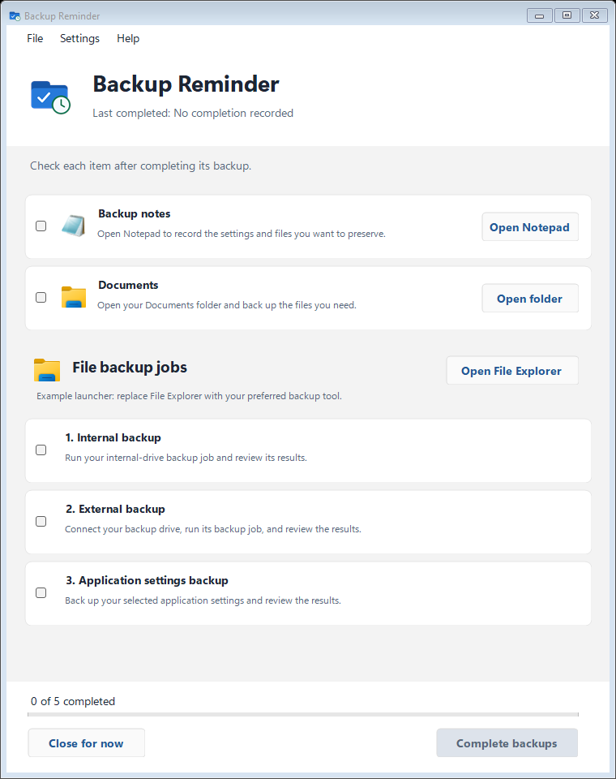
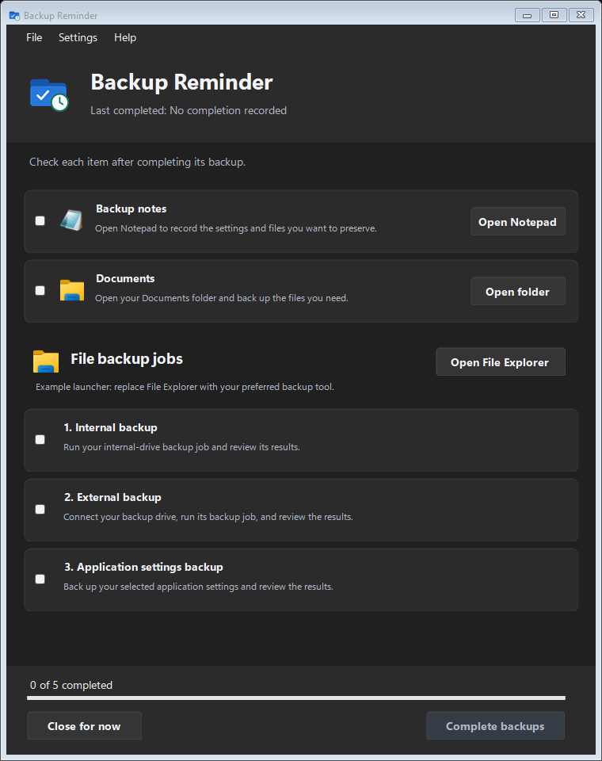

# Backup Reminder

A Windows checklist for the backups you prefer to do yourself. Open your tools, perform each backup, review the results, then check it off.

**Version: 0.2.1.** Portable Windows x64 app, tested on Windows 11. See the [release history](CHANGELOG.md).

## Screenshots

The generic starter has two standalone examples and a group with three independently checked jobs.

| Light appearance | Dark appearance |
| --- | --- |
|  |  |

## Features

- Opens configured backup tools, folders, or webpages.
- Supports individual tasks and grouped jobs with a shared launcher.
- Saves partial progress and records completion when every item is checked.
- Keeps data profiles separate and activates an existing window on relaunch.
- Includes a checklist editor, searchable Help, About, and System/Light/Dark appearance choices.
- Uses softly rounded cards/buttons and Windows 11 window preferences where supported.

The project started with a simple need: some backups are best performed manually, but remembering every step is easy to overlook. The optional Windows reminder opens this checklist on your chosen schedule.

A completed checklist records your confirmation. It does not independently verify backup integrity or restorability. Opening a tool never checks off a task automatically.

## Getting started

Download [Backup-Reminder-0.2.1-win-x64.zip](https://github.com/DGX-Development/Backup-Reminder/releases/download/v0.2.1/Backup-Reminder-0.2.1-win-x64.zip) from the [release page](https://github.com/DGX-Development/Backup-Reminder/releases/tag/v0.2.1), extract the ZIP to a permanent folder, and double-click **Backup-Reminder.exe**. The Windows x64 build includes its .NET runtime and does not require PowerShell or a separately installed .NET runtime. Keep the included app license and Microsoft runtime licenses/notices with it.

There is no installer or automatic updater. Enable optional reminders in Settings; installing or updating does not create a reminder automatically.

> **Windows security notice:** This app is not digitally signed, so Windows may display "Windows protected your PC" or an "unrecognized app" warning.
>
> If you downloaded it from this repository's official GitHub Releases page and trust the source, select **More info → Run anyway**. A SHA256 checksum is included with the download so you can verify the file.
>
> If Windows reports a specific malware detection, stop rather than treating it as the same warning.

## Basic use

1. Open **File > Edit checklist** to replace the generic examples with your own tasks and groups.
2. Open each backup tool, folder or webpage, perform the backup, review its results, then check the item.
3. Choose **Complete backups** when every item is checked. Closing the window saves unfinished progress and exits.
4. Optionally enable **Settings > Reminder schedule**. Reminders open the checklist while you are signed in; they do not run backup jobs.

Your settings and progress live separately from the executable. Use **Settings > Open data folder** to find them. See the [user guide](docs/user-guide.md) for configuration backup/restore, reminder behavior and safe updates.

## Documentation

- [User guide](docs/user-guide.md) — checklist editing, icons, profiles, configuration backup/restore, reminders, updates and more screenshots.
- [Portable instructions](docs/Portable-Readme.txt) — standalone instructions included in the download.
- [Changelog](CHANGELOG.md) — release history.

## Help and feedback

Use the app's searchable Help. **Help > Report an issue** opens a [GitHub issue form](https://github.com/DGX-Development/Backup-Reminder/issues/new); sign in to GitHub to submit a report.
Include your app version and reproduction steps without private backup paths or personal data.
About links to the developer website, [DGX.digitalguy.me](https://dgx.digitalguy.me).

## License and attribution

Backup Reminder is source available under the [PolyForm Noncommercial License 1.0.0](LICENSE), whose official text is included unchanged. Permitted noncommercial use, modification and distribution are governed by that license. Microsoft runtime components retain their own licenses and notices, included with self-contained builds. Installed app icons and third-party trademarks are not covered by this project's license.

Credit to DigitalGuy when sharing or adapting this project is appreciated but optional. This request adds no conditions to the license.
