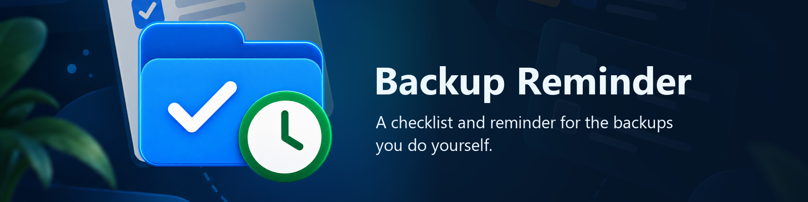
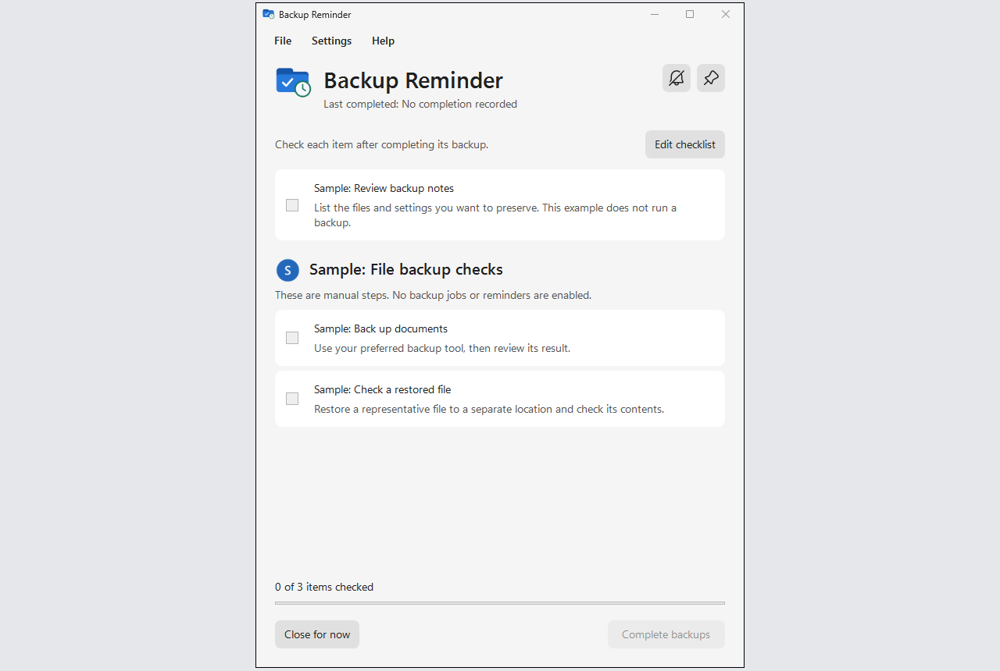
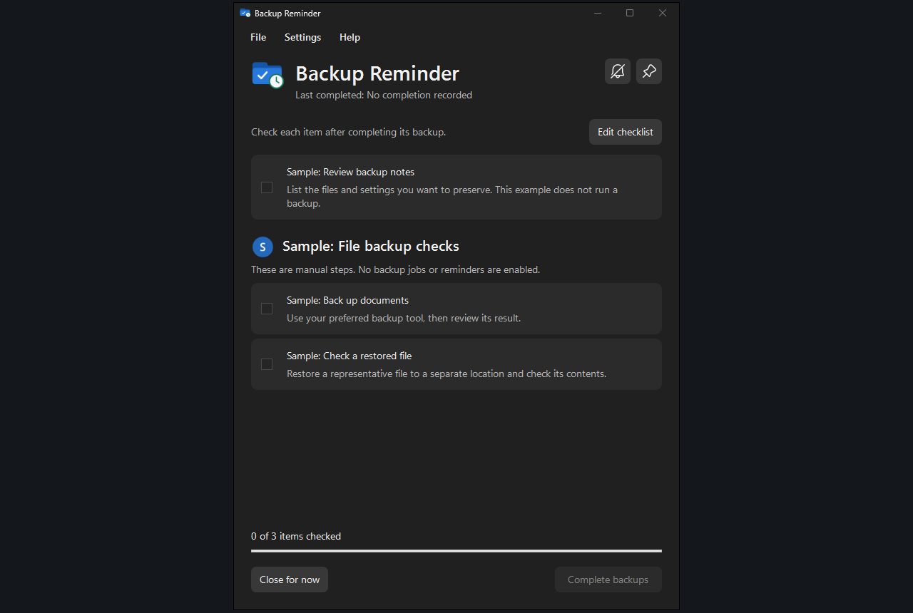

# Backup Reminder

A Windows checklist for the backups you prefer to do yourself. Open your tools, perform each backup, review the results, then check it off.

**Current release: 1.0.2.**

[Windows installer](https://github.com/DGX-Development/Backup-Reminder/releases/download/v1.0.2/Backup-Reminder-1.0.2-Setup.exe) | [Portable ZIP](https://github.com/DGX-Development/Backup-Reminder/releases/download/v1.0.2/Backup-Reminder-1.0.2-Portable.zip) | [SHA-256 checksums](https://github.com/DGX-Development/Backup-Reminder/releases/download/v1.0.2/SHA256SUMS.txt)

[**Download published Backup Reminder 0.3.1 for Windows x64**](https://github.com/DGX-Development/Backup-Reminder/releases/download/v0.3.1/Backup-Reminder-0.3.1-win-x64.zip)

## Screenshots

Version 1.0.2 with optional samples loaded. New profiles start empty. Select either screenshot to open its native-size capture.

| Light appearance | Dark appearance |
| --- | --- |
|  |  |

## Features

- Opens configured backup tools, folders, or webpages.
- Supports individual tasks and grouped jobs with a shared launcher.
- Saves partial progress and records completion when every item is checked.
- Keeps data profiles separate and activates an existing window on relaunch.
- Includes a checklist editor, searchable Help, About, and System/Light/Dark appearance choices.
- Uses softly rounded cards/buttons, refined menus with consistent line icons, and Windows 11 window preferences where supported.

The project started with a simple need: some backups are best performed manually, but remembering every step is easy to overlook. The optional Windows reminder opens this checklist on your chosen schedule.

A completed checklist records your confirmation. It does not independently verify backup integrity or restorability. Opening a tool never checks off a task automatically.

## Getting started

Download [Backup-Reminder-0.3.1-win-x64.zip](https://github.com/DGX-Development/Backup-Reminder/releases/download/v0.3.1/Backup-Reminder-0.3.1-win-x64.zip) from the [release page](https://github.com/DGX-Development/Backup-Reminder/releases/tag/v1.0.2), extract the ZIP to a permanent folder, and double-click **Backup-Reminder.exe**. The Windows x64 build includes its .NET runtime and does not require PowerShell or a separately installed .NET runtime. Keep the included app license and Microsoft runtime licenses/notices with it.

Version 1.0.2 provides an installer and portable ZIP. Help > Check for updates checks GitHub; updates are installed manually. Installing or updating does not enable reminders automatically.

> **Windows security notice:** This app is not digitally signed, so Windows may display "Windows protected your PC" or an "unrecognized app" warning.
>
> If you downloaded it from this repository's official GitHub Releases page and trust the source, select **More info → Run anyway**. A SHA256 checksum is included with the download so you can verify the file.
>
> If Windows reports a specific malware detection, stop rather than treating it as the same warning.

## Basic use

1. Choose **Edit checklist** on the main page to add tasks and groups, or restore your configuration backup.
2. Open each backup tool, folder or webpage, perform the backup, review its results, then check the item.
3. Choose **Complete backups** when every item is checked. Checkmarks save as they change. X and Minimize can hide the app in the tray; **File > Exit** quits.
4. Optionally enable **Settings > Reminder schedule**. Reminders open the checklist while you are signed in; they do not run backup jobs.

Installed data lives in `%LOCALAPPDATA%\Backup Reminder`. Portable data lives in the `profile` folder beside the executable. See the [user guide](docs/user-guide.md) for configuration backup/restore, reminder behavior and safe updates.

## Documentation

- [User guide](docs/user-guide.md) - checklist editing, icons, profiles, configuration backup/restore, reminders, updates and more screenshots.
- [Portable instructions](docs/Portable-Readme.txt) - standalone instructions included in the download.
- [Development and verification](docs/development.md) - build the current desktop installer and portable archive.
- [Changelog](CHANGELOG.md) - release history.

## Help and feedback

Use the app's searchable Help. **Help > Report an issue** opens a [GitHub issue form](https://github.com/DGX-Development/Backup-Reminder/issues/new); sign in to GitHub to submit a report.
Include your app version and reproduction steps without private backup paths or personal data.
About links to the developer website, [DGX.digitalguy.me](https://dgx.digitalguy.me).

## License and attribution

Backup Reminder is source available under the [PolyForm Noncommercial License 1.0.0](LICENSE), whose official text is included unchanged. Permitted noncommercial use, modification and distribution are governed by that license. Microsoft runtime components retain their own licenses and notices, included with self-contained builds. Installed app icons and third-party trademarks are not covered by this project's license.

Credit to DigitalGuy when sharing or adapting this project is appreciated but optional. This request adds no conditions to the license.
