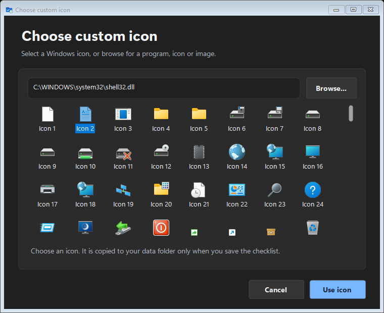

# Backup Reminder user guide

[Back to the project README](../README.md)

For downloading and opening the app, see [Getting started](../README.md#getting-started).
The app also includes searchable Help.

- [Your configuration and backups](#your-configuration-and-backups)
- [Edit your checklist](#edit-your-checklist)
- [Profiles and command-line options](#profiles-and-command-line-options)
- [Custom icons and browse locations](#custom-icons-and-browse-locations)
- [Reminders](#reminders)
- [Updates](#updates)
- [More screenshots](#more-screenshots)

## Your configuration and backups

Use **Settings > Open data folder** to find the active profile. By default it is `%LOCALAPPDATA%\Backup Reminder`.

| File | Contents |
| --- | --- |
| `settings.json` | Checklist items, groups, descriptions, launch paths, icon choices, reminder preferences, and `playReminderSound`/`reminderSoundPath` |
| `checklist.json` | Partial checkmarks, per-item `checkedAt` timestamps, and last completion date |

Use **File > Back up configuration** to save settings, progress, custom icons and WAV sound in one ZIP. **File > Restore configuration** validates it and preserves the current configuration in `recovery/before-restore.zip`. Restore turns reminders off; review program paths and enable reminders in Reminder schedule when ready. ZIPs contain personal paths and preferences; keep them private. They do not contain your backup tools, documents or Windows task definitions. Unavailable custom files are reported.

### Imported icons and sounds

Save imports custom icons into `icons/` and custom WAV files into `sounds/` in the active data folder. Paths are relative to that profile; originals are preserved. Icons selected from EXEs are extracted as PNG images. Discarding unsaved edits imports nothing. Existing external references remain supported and available files are imported on the next settings save; missing files retain the normal fallback. Only unreferenced files previously imported by the app are eligible for automatic cleanup.

### Manual backup

For manual backup or restore, close the app and copy the entire data folder, including `icons/` and `sounds/`. Also preserve any unavailable external files if you later recover them. Updates replace application files while preserving this data folder. Existing settings are not replaced with examples on startup.

## Edit your checklist

The first launch creates settings from the embedded generic starter. Use **File > Edit checklist** to manage tasks in one outline, with each group's tasks nested beneath it. **Add task** adds to the selected group. Select an entry to edit its **Name**, **Description**, and **What to open** (nothing, a program/file, a folder, or a website). Choose **None (show as a separate task)** for an independent item. **More options** reveals group assignment, button text, custom icons, arguments and working directory.

Save changes applies the draft and leaves the editor open. The button becomes **Saved** and disables until another edit.

Cancel, Close, X or Escape prompts **Save changes**, **Discard changes**, or **Keep editing** when a draft differs from the saved values; already saved pages close immediately. Failed saves keep the editor open and retain unsaved changes.

Existing task IDs and current checkmarks are retained. Moving across a group boundary moves that group as a unit; moving inside it reorders its tasks. [settings.example.json](../settings.example.json) shows the underlying format for manual editing while the app is closed.

### Advanced configuration

- Items need stable unique `Id` and `Title` values. Optional fields include `Detail`, `Target`, `Button`, `IconPath`, `IconWidth`, `IconHeight`, and `Group`.
- A target can be an executable, folder, or HTTP/HTTPS URL. Environment variables are expanded. `knownfolder:Documents` and `knownfolder:Pictures` follow redirected Windows folders.
- `Arguments` and `WorkingDirectory` optionally customize executable launches in the C# version. Only configure targets you trust.
- Icons can come from local images, ICO files, or installed executables. Display boxes preserve aspect ratio and are bounded to 16–40 pixels wide and 16–48 high.
- Groups have their own stable ID, title, detail, target, button and icon. An item's `Group` selects its group. The editor keeps group tasks together and preserves IDs when renaming or reordering.

## Profiles and command-line options

```text
Backup-Reminder.exe --development
Backup-Reminder.exe --data-directory "%LOCALAPPDATA%\BackupReminderExample"
Backup-Reminder.exe --appearance Dark
```

`--development` uses `%LOCALAPPDATA%\Backup Reminder\Development`. `--data-directory` overrides the default. The executable does not automatically select a project-local personal profile. Relative command-line paths resolve from the process working directory; use absolute paths for shortcuts.

## Custom icons and browse locations

Custom icons and sounds keep readable filenames in the active profile; different files sharing a name receive numbered suffixes. Sound Browse opens beside its selected file. Custom icon Browse shows icons from the current file/program, or the Windows shell32 library, with Browse to choose another source. Selected library icons are copied as PNGs on Save. Program/file Browse defaults to Program Files; folder and working-directory Browse use the current folder, with Documents as the final fallback (working directory first tries the selected program folder). Configuration backup/restore dialogs start in Documents. Existing hashed files migrate on Save, and older configuration backups remain supported.

### Custom icon chooser

Choose an individual Windows or program icon, or browse for an image. Your selection is imported only when you save the checklist.



## Reminders

**Settings > Reminder schedule** creates a real Windows scheduled task. Choose a monthly day and local time, turn on **Enable scheduled reminders**, then click **Save schedule**. Date and time follow your Windows regional settings; the interval start date has a calendar button. A live summary confirms the selected timing. The page reports the actual Windows task status and next run.

The task appears directly under Task Scheduler Library, named `Backup Reminder - <Windows username>`. Additional profiles include a readable profile label; matching names receive numbered suffixes. To stop reminders, clear Enable and click Save schedule; this removes only the current profile's task and retains its timing preferences.

The button becomes **Saved** and disables after a successful save; any timing or notification edit enables **Save schedule** again. Leaving unsaved edits prompts Save changes, Discard changes or Keep editing. Sound Preview does not mark settings as changed.

### Sound and attention

**Notification > Play a sound for scheduled reminders** is on by default; clear it and save for silent reminders. Expand **Sound options** to choose the Windows sound or a custom `.wav` file with **Browse** and **Preview**. Preview uses the unsaved selection; **Save schedule** keeps your choice. A missing, invalid or unplayable custom file falls back to the Windows Information sound. Playback follows Windows volume and sound settings. Manual launches remain quiet. Scheduled reminders request the selected sound once and briefly highlight the taskbar only when the app is behind another window. An open dialog or unsaved checklist edit is left intact; attention uses the same taskbar button and does not steal focus.

### Timing and checklist progress

Monthly days 29-31 fall back to the last day of shorter months. Alternatively choose an interval of 1-365 days and a start date. Existing timing preferences remain off until explicitly enabled; installing or updating the app does not silently create a reminder. Completing backups early never moves or skips a reminder.

Closing saves unfinished checkmarks and exits completely; completing records a finished session and clears checks for next time. A later reminder preserves unfinished progress.

Checked items show the local date/time you checked the box, not a verified backup time. Unchecking clears that timestamp; completing clears all item timestamps. Existing undated checkmarks show "Checked date not recorded" rather than an invented date. Renaming/reordering retains timestamps by stable item ID. There is no tray/background process after closing.

### Windows task behavior

The task runs with your signed-in Windows account, without administrator elevation or a stored password. It opens the same app and data profile; it runs no backup jobs. A running copy is reused instead of duplicated. A manual relaunch activates its existing window or open dialog; a scheduled reminder uses sound and taskbar attention without forcing that window to the front. Windows may run a missed reminder later; catch-up is not necessarily immediate. Your PC is not woken from sleep, and you must be signed in for the window to appear.

Extract the app to a permanent folder before enabling reminders. If you move it, open it from the new location and save the schedule again to update the task's launch path. Replacing it at the same path preserves the task.

Existing owned tasks with recognized actions at that executable path automatically gain readable account/profile names and the scheduled-launch marker on the next normal app launch, without changing their triggers, enabled state or next run. Profile identity stays in task metadata. Tasks pointing elsewhere are not rewritten. Different profiles have separate tasks.

Task Scheduler definitions are Windows state, so after restoring your JSON configuration on another PC, review paths and enable reminders in Reminder schedule, then save to register it. Disable reminders before resetting or abandoning a profile. Save failures preserve configuration and attempt to restore the prior task; errors are shown rather than claiming success.

## Updates

1. Close Backup Reminder.
2. Download and extract the new release ZIP.
3. Replace all supplied application files in the **same app folder**.
4. Reopen Backup Reminder.

Your settings, progress, icons and sounds stay in the separate data folder. Keeping the EXE at the same path preserves the Windows reminder. If you move it, open it from the new location and save the schedule again. Never overwrite personal data with starter examples. There is no automatic updater.

For searchable Help, issue reporting and the developer website, see [Help and feedback](../README.md#help-and-feedback).

## More screenshots

The [README](../README.md#screenshots) shows the starter checklist in light and dark appearances.

| Feature | Light appearance | Dark appearance |
| --- | --- | --- |
| Checklist editor | [View](../assets/screenshots/checklist-editor.png) | [View](../assets/screenshots/checklist-editor-dark.png) |
| Reminder preferences | [View](../assets/screenshots/reminder-preferences.png) | [View](../assets/screenshots/reminder-preferences-dark.png) |
| Sound options | [View](../assets/screenshots/reminder-sound-options-light.png) | [View](../assets/screenshots/reminder-sound-options-dark.png) |
| Searchable Help | [View](../assets/screenshots/help.png) | [View](../assets/screenshots/help-dark.png) |
| Unsaved changes | [View](../assets/screenshots/unsaved-changes-light.png) | [View](../assets/screenshots/unsaved-changes-dark.png) |
